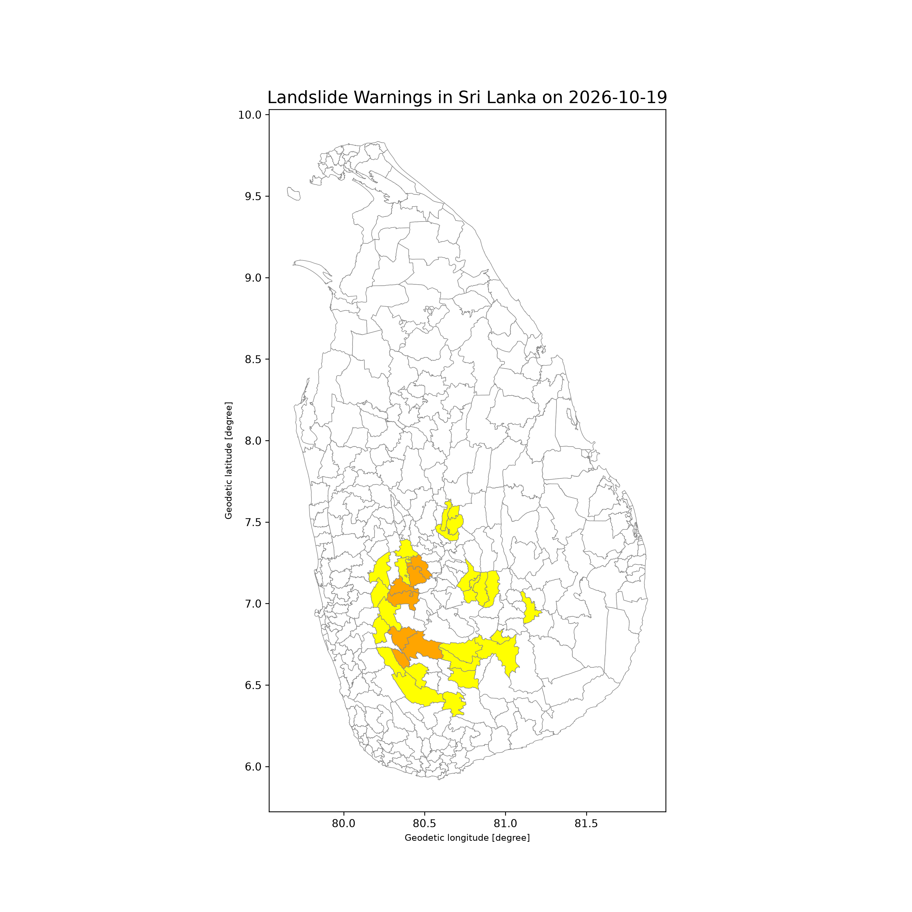

# 🇱🇰 Sri Lanka: Landslide Warnings

From the [Disaster Management Centre](https://www.dmc.gov.lk/index.php?option=com_dmcreports&view=reports&Itemid=276&report_type_id=5&lang=en).

## Landslide Warning Map

## Latest Warnings (2026-10-24)

### 🟡 Level 1 - "watch"

#### `LK-92` Kegalle

- `LK-9206` Mawanella
- `LK-9209` Aranayake
- `LK-9221` Ruwanwella
- `LK-9227` Yatiyantota
- `LK-9230` Dehiowita
- `LK-9233` Deraniyagala

#### `LK-23` Nuwara Eliya

- `LK-2314` Norwood

#### `LK-91` Ratnapura

- `LK-9106` Kuruvita
- `LK-9112` Ratnapura
- `LK-9127` Elapatha

### 🟠 Level 2 - "alert"

### 🛑 Level 3 - "evacuate"
