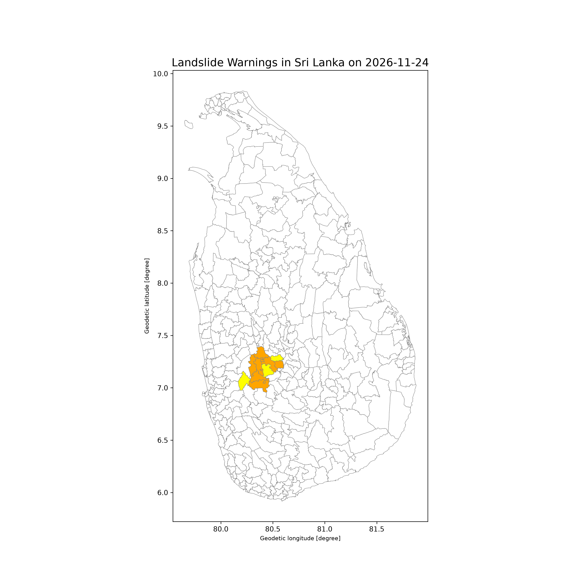

# 🇱🇰 Sri Lanka: Landslide Warnings

From the [Disaster Management Centre](https://www.dmc.gov.lk/index.php?option=com_dmcreports&view=reports&Itemid=276&report_type_id=5&lang=en).

## Landslide Warning Map

## Latest Warnings (2026-11-21)

### 🟡 Level 1 - "watch"

#### `LK-21` Kandy

- `LK-2103` Tumpane
- `LK-2130` Gangawata Korale
- `LK-2134` Hatharaliyadda
- `LK-2157` Pasbagekorale

#### `LK-92` Kegalle

- `LK-9203` Rambukkana
- `LK-9209` Aranayake
- `LK-9215` Galigamuwa

### 🟠 Level 2 - "alert"

#### `LK-21` Kandy

- `LK-2136` Yatinuwara

#### `LK-92` Kegalle

- `LK-9206` Mawanella

### 🛑 Level 3 - "evacuate"
