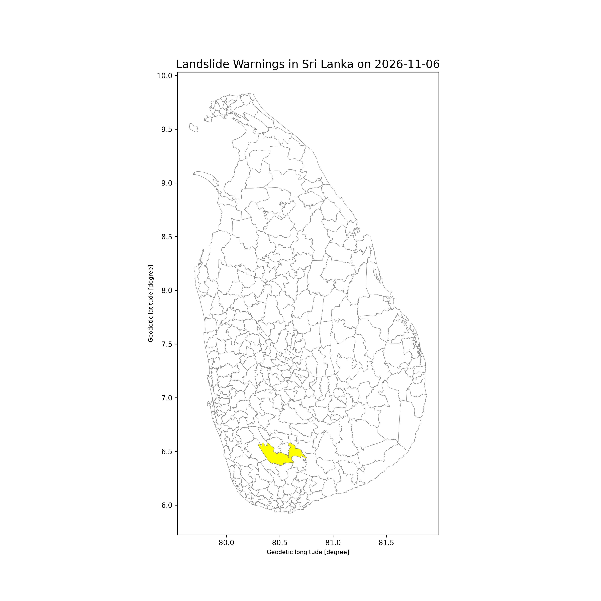

# 🇱🇰 Sri Lanka: Landslide Warnings

From the [Disaster Management Centre](https://www.dmc.gov.lk/index.php?option=com_dmcreports&view=reports&Itemid=276&report_type_id=5&lang=en).

## Landslide Warning Map

## Latest Warnings (2026-11-14)

### 🟡 Level 1 - "watch"

#### `LK-81` Badulla

- `LK-8115` Soranathota
- `LK-8118` Passara
- `LK-8121` Badulla
- `LK-8124` Hali-Ela
- `LK-8133` Bandarawela
- `LK-8136` Ella

#### `LK-21` Kandy

- `LK-2136` Yatinuwara
- `LK-2139` Udunuwara

#### `LK-92` Kegalle

- `LK-9206` Mawanella
- `LK-9209` Aranayake
- `LK-9227` Yatiyantota

#### `LK-23` Nuwara Eliya

- `LK-2314` Norwood
- `LK-2315` Ambagamuwa Korale

#### `LK-91` Ratnapura

- `LK-9103` Eheliyagoda
- `LK-9127` Elapatha
- `LK-9130` Ayagama
- `LK-9145` Weligepola

### 🟠 Level 2 - "alert"

### 🛑 Level 3 - "evacuate"
